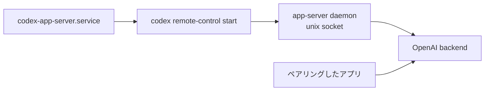

# Codex の app-server を remote control で常駐させる

`llm-agents` の flake が配布する Codex CLI の app-server daemon を、NixOS の systemd ユーザーサービスとして常駐させる。remote control を有効にすると、app-server は OpenAI のバックエンドへ外向きに接続し、ChatGPT のデスクトップアプリやモバイルアプリからペアリングして操作できる。受信ポートを開かないため、Tailscale Serve も capability token も使わない。

## 構成



`home/linux/codex.nix` がユーザーサービスと、daemon の復帰用タイマーを定義する。daemon は `~/.codex` 配下に状態と自分のパッケージを持ち、`codex` の CLI が切り離して起動する。

## サーバーの起動

サービスは `codex remote-control start` を oneshot で実行する。このコマンドは daemon を起動して remote control を有効にし、起動が済むと戻る。停止時は `codex remote-control stop` が daemon を止める。

daemon はサービスの主プロセスではなく、切り離されたプロセスとして動く。そのため落ちても unit は active のまま残る。`codex-app-server-healthcheck` タイマーが 5 分ごとに `remote-control start` を再実行し、停止した daemon を復帰させる。

remote control は外向きの接続だけで成立する。tailnet への公開も、待ち受けポートも、token も要らない。

## ログインとペアリング

app-server はホストのユーザーの `~/.codex` をそのまま使う。最初にホストで一度ログインする。

```bash
codex login
```

ペアリングコードはホストで次のコマンドを実行して得る。

```bash
codex remote-control pair
```

表示されるコードは有効期限が短い。ChatGPT のアプリ側でコードを入力すると、そのアプリがこのホストの app-server に接続する。

## 状態を確認する

```bash
systemctl --user status codex-app-server
journalctl --user -u codex-app-server -f
codex app-server daemon version
```

変更を反映するときは、リポジトリのルートで次を実行する。

```bash
sudo nixos-rebuild switch --flake .#nixos
```

Codex のパッケージを更新したあとは、`systemctl --user restart codex-app-server` で daemon を新しいバイナリへ切り替える。

## 対象外

macOS のホストではこのサービスを動かさない。
