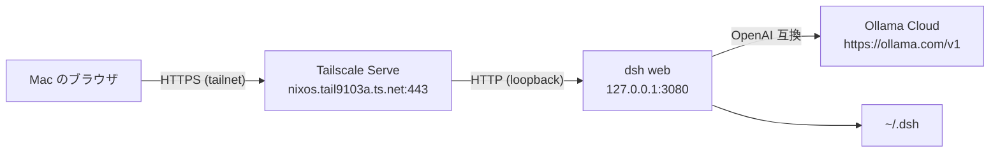

# dsh の Web UI を tailnet に公開する

dsh は DeepSeek Harness の CLI である。`dsh web` を付けて起動するとブラウザから同じエージェントを操作できる。このリポジトリでは NixOS ホストで `dsh web` を systemd のユーザーサービスとして常駐させ、Tailscale Serve で tailnet へ HTTPS で公開している。Mac からはブラウザで `https://nixos.tail9103a.ts.net/` を開くだけで使える。

## 構成

経路は 3 つの層に分かれている。



- パッケージは `modules/llm-agents.nix` が `inputs.llm-agents` から取り、`environment.systemPackages` に入れる。macOS と NixOS の両方に入るため、対話の `dsh` と `dsh tui` はどちらのホストでも動く
- サービスは `home/linux/dsh-web.nix` が定義する。systemd のユーザーサービスとして `dsh web` を起動し、loopback の 3080 番で待ち受ける
- 公開は `modules/nixos/tailscale.nix` の `tailscale-serve-dsh` が担う。tailnet の 443 番を loopback の 3080 番へ流し、`tailscale0` の 443 番をファイアウォールで許可する
- プロファイル、セッション、認証の記録は `~/.dsh` に置く。home-manager はこのディレクトリを管理しない

ユーザーサービスとして動かすのは、エージェントが選んだワークスペースのファイルを直接読み書きするためである。NixOS ホストは `modules/nixos/docker.nix` が linger を有効にしているので、ログインしていなくてもサービスは起動している。

## 初回のアクセス

dsh は起動のたびに新しいトークンを作り、認証を通す URL を出力する。トークンは journal に残るので、次のコマンドで取り出す。

```bash
journalctl --user -u dsh-web -n 20 | grep 'dsh web:'
```

出力された `https://nixos.tail9103a.ts.net/?token=...` をブラウザで開く。dsh はトークンを `GET /` でだけ受け付け、`tailnet の authority に結び付いた cookie` を書いてから、トークンを落とした URL へリダイレクトする。cookie の有効期限は 30 日で、その間はトークン無しで開ける。トークンはプロセスごとに変わるが、cookie の署名に使う鍵は `~/.dsh/.credentials.yaml` に残るため、サービスの再起動でログインが切れることはない。

トークンが漏れても tailnet の外からは届かない。ただし tailnet に参加している端末からは誰でもその URL を開けてしまうため、URL を共有しない。

## ブラウザからのリクエストを信頼させる仕組み

dsh は DNS リバインディングと cross-site の要求を防ぐため、すべての要求の `Host` ヘッダを検査する。loopback か、`--trusted-host` に登録した authority だけを認め、それ以外は 403 で拒否する。Tailscale Serve は `Host` ヘッダをそのまま上流へ渡すので、サービスは `--trusted-host nixos.tail9103a.ts.net` を付けて起動している。ポートを省いた指定は任意のポートに一致する。

`--public-url` は起動時に journal へ出す URL を組み立てるだけで、信頼の判定には影響しない。`https` で公開しているため、ブラウザが付ける `Origin` も同じ authority になり、WebSocket の接続も通る。

## モデルの設定

このホストの他のエージェントと同じく、モデルは Ollama Cloud の OpenAI 互換エンドポイントを使う。API キーは agenix が復号する `ollama-api-key` を、起動時に `OLLAMA_API_KEY` として環境へ読み込む。

経路の宣言は `home/linux/dsh-web.nix` の `providerPatch` が YAML として持ち、`--patch` でプロファイルへ重ねている。dsh の設定は層になっており、`--patch` はプロファイル層より後ろに適用されるため、対話で使う `dsh` が `~/.dsh` に持つ自分の設定を書き換えない。

`--patch` は dsh 本体のフラグなので、アプリのフラグより先に置く。後ろに置くと `web` アプリの引数として渡り、未知のフラグとして拒否される。

```bash
# 正しい順序
dsh web --patch /path/to/patch.yml --port 3080 --no-open

# エラーになる
dsh web --port 3080 --patch /path/to/patch.yml
```

対話の dsh でも同じ経路を使いたい場合は、`~/.dsh/cordis.patch.yml` に同じ内容を置く。このファイルは全プロファイルに適用されるホーム層で、`--patch` より前に重なる。

## 変更するとき

- ポートを変えるときは `home/linux/dsh-web.nix` の `--port`、`modules/nixos/tailscale.nix` の `localPort`、`--public-url` と `--trusted-host` の値を揃える
- 公開するポートを変えるときは `tailnetPort` とファイアウォールの `allowedTCPPorts` を揃える
- 使うモデルを変えるときは `providerPatch` の `models` と `agent-default-model` を書き換える

状態を確認するときは次のコマンドを使う。

```bash
systemctl --user status dsh-web
tailscale serve status
```
