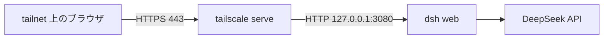

# dsh の Web UI を Tailscale Serve で公開する

`llm-agents` の flake が配布する dsh (DeepSeek Harness) の Web UI を、NixOS の systemd ユーザーサービスとして常駐させる。dsh はループバックの 3080 番だけで待ち受け、Tailscale Serve が tailnet 向けの HTTPS 終端としてその前に立つ。tailnet に参加している端末から `https://nixos.tail9103a.ts.net/` を開いて使う。

## 構成



- `modules/llm-agents.nix` が `inputs.llm-agents` から `dsh` を引いて systemPackages へ入れる
- `home/linux/dsh-web.nix` が `dsh web` を systemd ユーザーサービスとして動かす。起動時に `tailscale status --json` から MagicDNS 名を読み、`--trusted-host` と `--public-url` に渡す
- `modules/nixos/dsh-web.nix` が `tailscale serve --bg --https=443 http://127.0.0.1:3080` を oneshot で適用する。tailscaled のバックエンドが Running になるまで最大 5 分待つ

`dsh web` は `127.0.0.1` にだけ bind する。Tailscale Serve の公開範囲は tailnet の中だけで、Funnel は使わない。ファイアウォールにポートを追加する必要もない。

dsh は起動ディレクトリをワークスペースのルートにする。サービスは `%h` で動くため、ホームディレクトリ配下のリポジトリを対象にできる。

## 反映と状態の確認

変更を反映する。

```bash
sudo nixos-rebuild switch --flake .#nixos
```

サービスと Serve の状態を見る。

```bash
systemctl --user status dsh-web
systemctl status dsh-web-tailscale-serve
tailscale serve status
```

## 最初に開く URL

`dsh web` は起動時にプロセストークン付きの URL を journal へ出す。次のコマンドで取り出す。

```bash
journalctl --user -u dsh-web -g 'dsh web:'
```

表示された `https://nixos.tail9103a.ts.net/?token=...` を tailnet 上の端末で開くと、トークンが署名付き Cookie に交換され、トークンなしの URL へリダイレクトされる。トークンはプロセスごとに変わるため、サービスを再起動したら取り直す。URL には資格情報が入るので、他の人と共有しない。

トークンなしで開くと 401 になる。トークンは一度使うと Cookie に置き換わり、以後は Cookie だけで認証される。

## モデルの設定

最初の起動ではモデルの資格情報が無い。ブラウザで Settings から Models を開き、DeepSeek の API キーを保存する。キーは `~/.dsh/.credentials.yaml` に保存され、設定側には参照だけが残る。`DEEPSEEK_API_KEY` を環境変数で渡すこともできる。設定の変更は次のリクエストから反映され、サービスの再起動は要らない。

## 更新と停止

dsh のパッケージを更新したあとは、ユーザーサービスを再起動して新しいバイナリへ切り替える。

```bash
systemctl --user restart dsh-web
```

Tailscale Serve の設定は tailscaled の状態に保存される。ノードの状態を作り直したときや設定を適用し直したいときは、システム側のサービスを再起動する。

```bash
sudo systemctl restart dsh-web-tailscale-serve
```

443 番の handler だけを外したいときは `sudo tailscale serve --https=443 off` を実行する。`dsh-web-tailscale-serve` を止めたときも、この handler は自動で外れる。

## 対象外

macOS のホストではこのサービスを動かさない。dsh の CLI 自体は `modules/llm-agents.nix` が両プラットフォームへ入れる。
