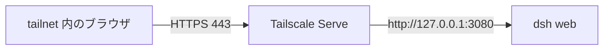

# dsh

NixOS ホストで DeepSeek Harness (dsh) の Web UI を起動し、Tailscale Serve 経由で tailnet 内のブラウザから HTTPS でアクセスできるようにする。

## 構成



- `dsh-web.service` は `config.my.primaryUser` として dsh を実行する。HOME と WorkingDirectory をそのユーザーのホームに設定し、dsh は `~/.dsh` に状態を保存する。
- `dsh-tailscale-serve.service` は `tailscale serve --bg --https=443 http://127.0.0.1:3080` を実行し、tailnet からの HTTPS 接続を `127.0.0.1:3080` に転送する。
- dsh は `127.0.0.1:3080` のみで待ち受ける。Tailscale Serve が実際の TLS と外部到達性を担う。

## 前提

- Tailscale の MagicDNS と tailnet HTTPS 証明書が有効になっていること。これは Tailscale 管理者コンソールで一度だけ設定する。
- ホストが tailnet にログイン済みで、`tailscale status --json` の `.BackendState` が `Running` であること。起動時に `.Self.DNSName` から `https://nixos.<tailnet>.ts.net/` などの FQDN を取得する。

## tailnet からのアクセス

ブラウザで以下の URL を開く。実際の tailnet 名は環境によって変わる。

```
https://nixos.<tailnet>.ts.net/
```

起動時に出力されるトークン付き URL を開くと、トークンがセッション cookie に交換される。トークンは dsh の再起動ごとに変わるため、初回と再起動後のアクセスでは journal から URL を取得する。

```bash
journalctl -u dsh-web -o cat -g 'dsh web:' | tail -n 1
```

## モデルの API キー

Web UI を開いたら Settings の Models から API キーを設定する。dsh は `~/.dsh/.credentials.yaml` にキーを保存する。

## 運用コマンド

```bash
systemctl status dsh-web dsh-tailscale-serve
systemctl restart dsh-web
```

`dsh-web` は Tailscale が未接続の状態で起動すると FQDN が取得できずに失敗する。`Restart=always` と `RestartSec=5` により、Tailscale が利用可能になるまで systemd が再起動を試みる。
