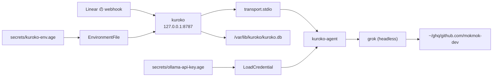

# kuroko を NixOS のサービスとして動かす

`github:mokmok-dev/kuroko` のデーモンを、このホストの systemd サービスとして常駐させる。kuroko は Linear の webhook を受け取り、委譲された課題を手元のコーディングエージェントへ渡す。上流の flake が NixOS モジュールを公開しているため、このリポジトリが持つのは flake input と、そのモジュールへ値を入れる短いファイルだけである。

## 構成



`modules/nixos/kuroko.nix` は上流の `nixosModules.default` を import し、`services.kuroko` にトランスポートとトリガ、作業ディレクトリ、秘密情報の場所を渡す。設定ファイルの生成、`/var/lib/kuroko` の用意、unit の定義は上流のモジュールが行う。生成された `/etc/kuroko/config.toml` には `127.0.0.1:8787` で待ち受ける設定と SQLite のパスだけが入り、秘密情報は含まれない。

## エージェント

kuroko は課題の本文を子プロセスの標準入力へ書き、終了コードだけで成否を判定する。そのため `settings.transport.stdio.command` には、grok を headless で起動する小さなスクリプトを渡している。スクリプトは credential から `OLLAMA_API_KEY` を読み、主要ユーザーの `~/.grok/config.toml` にあるモデル定義をそのまま使う。

`--always-approve` は、人が承認できない実行でツール呼び出しを止めないために付ける。`--prompt-file /dev/stdin` は kuroko が書いた本文をそのまま読ませる。ユーザーの `config.toml` は `ask_user_question` のタイムアウトを無効にしているので、サービス側でだけ 300 秒の上限を設けている。

## 誰として動かすか

サービスは主要ユーザー (`my.primaryUser`) として動く。エージェントはこのユーザーのリポジトリを編集し、その gh と git の認証を使うためである。上流のモジュールはサービス用のユーザーをシステムユーザーとして既定化するので、既存の通常ユーザーと衝突しないよう `users.users.<user>.isSystemUser` を `false` に打ち消している。

作業ディレクトリは `~/ghq/github.com/mokmok-dev` にしてある。kuroko はこのディレクトリでエージェントを起動するので、課題の本文にはどのリポジトリを触るかを書く。

## 秘密情報

`secrets/kuroko-env.age` は Linear の webhook 署名鍵を `KUROKO_LINEAR_SECRET` として持つ環境ファイルである。Linear で webhook を作ると署名鍵が発行されるので、その値を次のように入れる。

```bash
cd secrets
printf 'KUROKO_LINEAR_SECRET=%s\n' '<Linear の発行した値>' | AGENIX_RULES=./secrets.nix agenix -e kuroko-env.age
```

初回の作成時は、署名鍵がまだ無いためランダムな値を入れてある。webhook を作った時点で上のコマンドで置き換える。kuroko は署名鍵が無いと起動しないので、空のままにすると unit が再起動を繰り返す。

`ollama-api-key` は mokmok-agent と同じファイルを使い回す。サービス本体には渡さず、`LoadCredential` でエージェントのプロセスへだけ渡す。

## Linear 側の設定

Linear の設定で webhook を作り、URL に `http://<ホスト>:8787/webhooks/linear` を指定して Issues のリソースを選ぶ。kuroko は 8787 番で待ち受けるが、既定ではループバックに限られる。Linear から届かせるには Tailscale などの経路を用意し、`settings.server.bind` をそのインターフェースに合わせる。`trigger.any_delegate = true` にしてあるので、担当者をエージェントへ委譲すると課題が流れてくる。

## 状態を確認する

```bash
systemctl status kuroko
journalctl -u kuroko -f
curl -sS http://127.0.0.1:8787/tasks
ls -l /var/lib/kuroko
```

`/tasks` は課題ごとの状態を返す。`Succeeded` と `Failed` にはエージェントの出力の末尾が入る。`RecoveryPending` は、委譲したエージェントの結果を記録する前にデーモンが止まった課題である。外部エージェントの副作用は再実行できないため、kuroko はそれを自動で流し直さない。

## 変更を反映する

`modules/nixos/kuroko.nix` を編集して `sudo nixos-rebuild switch --flake .#nixos` を実行する。設定はストアに書かれるため、変更はビルドを通してのみ反映される。上流の flake を更新するときは `nix flake update kuroko` を実行し、`nixos-rebuild` の前に一度ビルドする。Rust のビルドは長いので、先にビルドだけを済ませておくと切り替えが速い。

## まだ無いもの

- OAuth でのインストールには対応していない。`services.kuroko.oauth` を設定すれば有効になるが、公開 HTTPS のコールバック URL が要るため、まず webhook の経路を決める
- Linear へ結果を書き戻す処理は kuroko の外にある。今は `/tasks` と journal で結果を読む
