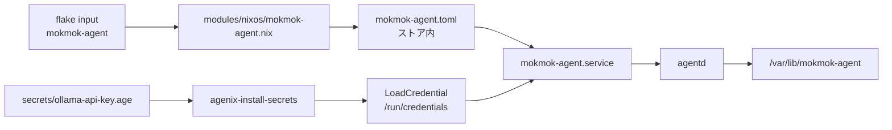

# mokmok-agent を NixOS のサービスとして動かす

`github:mokmok-dev/agent` のデーモン `agentd` を、このホストの systemd サービスとして常駐させる。上流の flake が NixOS モジュールを公開しているため、このリポジトリが持つのは flake input と、そのモジュールへ値を入れる短いファイルだけである。

## 構成



`modules/nixos/mokmok-agent.nix` は上流の `nixosModules.default` を import し、`services.mokmok-agent` にモデルとプロバイダ、directive、API キーの場所を渡す。設定ファイルの生成、サービス用のユーザーとグループの作成、`/var/lib/mokmok-agent` の用意、unit の定義はすべて上流のモジュールが行う。

## プロバイダとモデル

モデルは ollama-cloud の OpenAI 互換エンドポイント (`https://ollama.com/v1`) を `deepseek-v4.1-flash` で使う。

API キーは `secrets/ollama-api-key.age` を再利用する。ホームディレクトリ側の agenix は対話シェルの環境変数へ展開するだけなので、サービスからは読めない。そのため `modules/nixos/agenix.nix` に同じファイルをシステムの秘密情報としても登録し、`LoadCredential` でサービスへ渡す。復号が終わる前に unit が起動すると credential の読み込みに失敗するので、`agenix-install-secrets.service` の後に起動するよう並べている。

## 設定を変えるとき

`modules/nixos/mokmok-agent.nix` の `services.mokmok-agent` を編集して `sudo nixos-rebuild switch --flake .#nixos` を実行する。設定ファイルはストアに書かれるため、変更はビルドを通してのみ反映される。

`directive` は毎回のリクエストの先頭に置かれる。時刻やホスト名のように実行のたびに変わる値を入れると、プロバイダ側のプロンプトキャッシュが毎回無効になる。

## 状態を確認する

```bash
systemctl status mokmok-agent
journalctl -u mokmok-agent -f
ls -l /var/lib/mokmok-agent
systemd-analyze security mokmok-agent.service
```

unit は `Type=notify` と `WatchdogSec=30s` で動く。`agentd` はループを 1 回終えるたびにハートビートを送るので、ループが固まると systemd がプロセスを再起動する。`Restart=always` と `StartLimitIntervalSec=0` により、クラッシュしても再起動のレート制限で停止したままにはならない。

## まだ無いもの

- macOS 向けのモジュールは上流に無い。このリポジトリでも NixOS のホストだけで有効にしている
- `tools` は空にしてある。ツールを渡すのは、そのスキーマと実行時の副作用を決めてからにする
- 上流が公開しているのは `agentd` だけで、`agentctl` などの操作系はまだ実装されていない。今のサービスは起動してハートビートを送り続けるところまでを担う
