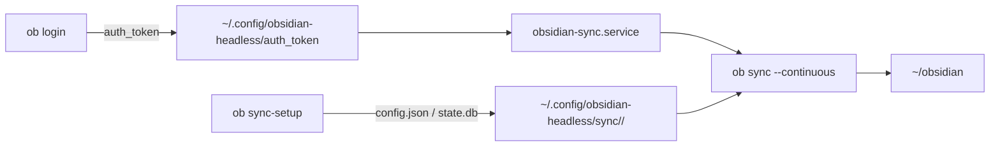

# Obsidian Headless で vault を継続同期する

Obsidian Headless の `ob` を NixOS の systemd ユーザーサービスとして常駐させ、`ob sync --continuous` で vault を同期し続ける。デスクトップアプリを起動せずに同期できるので、バックアップとエージェントからの読み取りに使える。

## 構成



`home/linux/obsidian-headless.nix` がパッケージとユーザーサービスを定義する。同期の対象は `~/obsidian` を前提にしている。

## 初期設定

公式ドキュメントが、開始前にデータをバックアップすること、同じデバイスでデスクトップアプリの Sync と Headless Sync を併用しないことを求めている。NixOS のホストはデスクトップアプリを動かさないので、後者は問題にならない。

次の 2 つは対話的に行うため、Nix の設定には含められない。

```bash
# アカウントにログインする。認証情報は ~/.config/obsidian-headless/auth_token に 0600 で書かれる。
ob login

# リモートの vault を選び、ローカルのパスと結び付ける。
mkdir -p ~/obsidian
ob sync-setup --vault "<リモートの vault 名>" --path ~/obsidian
```

`ob sync-setup` は `~/.config/obsidian-headless/sync/<vault-id>/` に `config.json` と `state.db` を書き、以降 `ob sync` はそれを読む。この状態はコマンドが作るものであり、Nix では管理していない。

vault を別の場所に置くなら、`home/linux/obsidian-headless.nix` の `vault` を同じパスに変える。`--path` が `ob sync-setup` に登録したパスと食い違うと同期は始まらない。

## サービスの起動

サービスは `default.target` に属するので、`nixos-rebuild switch` のあと自動で起動する。ログインと `ob sync-setup` が済んでいない間は `ob sync` が未設定として終了するため、`Restart=on-failure` と `RestartSec=30` で 30 秒おきに再試行する。初期設定を済ませれば、次の再試行から同期が始まる。`systemctl --user start` を別に叩く必要はない。

状態を確認する。

```bash
systemctl --user status obsidian-sync
journalctl --user -u obsidian-sync -f
```

## 変更を反映する

リポジトリのルートで次を実行する。

```bash
sudo nixos-rebuild switch --flake .#nixos
```

## 対象外

macOS のホストにはこのパッケージを入れていない。Obsidian はデスクトップアプリの Sync と Headless Sync を同じデバイスで併用すると競合すると警告しており、Mac はデスクトップアプリを同期の窓口にしている。
