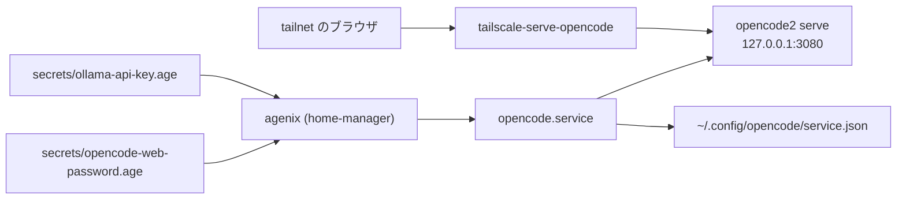

# OpenCode のサーバーと Web UI を tailnet に公開する

`llm-agents` の flake が配布する OpenCode 2 のサーバーを、NixOS の systemd ユーザーサービスとして常駐させる。サーバーは v2 API と Web UI を同じポートで提供するため、TUI とブラウザは 1 つのサーバーを共有する。tailnet への公開は Tailscale Serve が担う。

## 構成



`home/linux/opencode.nix` がユーザーサービスを定義し、`modules/nixos/tailscale.nix` が Tailscale Serve の転送を定義する。サーバーは `127.0.0.1:3080` で待ち受け、Tailscale Serve が tailnet の HTTPS (443) を受けてそのポートへ流す。ブラウザからは `https://nixos.tail9103a.ts.net/` で開ける。

## サーバーの起動

サービスは `opencode2 serve --service` を実行する。`--service` を付けるとサーバーはバックグラウンドサービスの登録を `~/.local/state/opencode/service.json` に書き、TUI はその登録を使って同じサーバーへ接続する。

`--service` のサーバーはパスワードを環境変数ではなく `~/.config/opencode/service.json` から読む。そのため起動スクリプトが `hostname`、`port`、`password` の 3 つのキーを先に書き込む。既存のファイルは読み込んでから上書きするので、`cors` や `env` など利用者が設定したキーは残る。

パスワードは `secrets/opencode-web-password.age` を agenix が復号したものである。ホスト上では次のコマンドで読める。

```bash
cat "$XDG_RUNTIME_DIR/agenix/opencode-web-password"
```

## ブラウザから接続する

初回に `https://nixos.tail9103a.ts.net/` を開くと接続画面が出るので、URL とパスワードを入れる。パスワードを入力せずに接続したいときは、ホストで次のコマンドを実行する。

```bash
opencode2 pair --url https://nixos.tail9103a.ts.net
```

一度だけ使えるリンクと QR コードが表示される。有効期限は 5 分なので、表示したらすぐに開く。接続したブラウザはパスワードを保存するため、次回からは URL を開くだけでよい。

## モデルの認証

サーバーは models.dev のカタログを使う。Ollama Cloud の API キーは `secrets/ollama-api-key.age` から読み、`OLLAMA_API_KEY` としてプロセスに渡す。systemd のユーザーサービスは対話シェルの環境を引き継がないため、この受け渡しが無いとモデルの一覧に Ollama Cloud が現れない。

ほかのプロバイダを使うときは、OpenCode の設定に認証情報を追加する。このサービスが環境変数で渡すのは Ollama Cloud のキーだけである。

## 状態を確認する

```bash
systemctl --user status opencode
journalctl --user -u opencode -f
tailscale serve status
```

変更を反映するときは、リポジトリのルートで次を実行する。

```bash
sudo nixos-rebuild switch --flake .#nixos
```

## 対象外

macOS のホストではこのサービスを有効にしていない。Tailscale Serve の公開も NixOS のモジュールだけで定義している。
