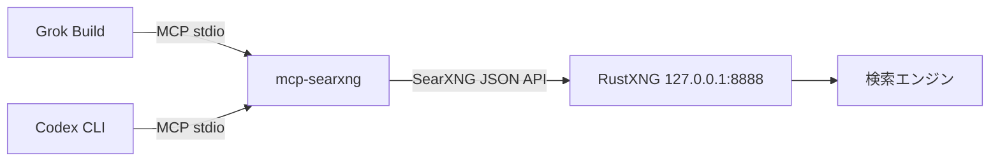

# RustXNG で Grok Build と Codex CLI に Web 検索を提供する

RustXNG をローカルで動かし、mcp-searxng を介して Grok Build の MCP サーバーとして使えるようにする。Grok のネイティブな `web_search` はクライアント側のツールで、検索先を差し替えられない。そこで SearXNG 互換の JSON API を返す RustXNG を立て、Grok からは MCP のツールとして呼ぶ。

Codex CLI も同じ mcp-searxng と RustXNG を使う。home-manager の activation で `codex mcp add` を実行し、`~/.codex/config.toml` に `rustxng` を登録する。この登録は `deepseek` を含む各プロファイルで使える。

## 構成



Grok は `~/.grok/config.toml` に登録した `rustxng` サーバーを起動し、標準入出力で mcp-searxng と話す。mcp-searxng は `SEARXNG_URL` で指定した `http://127.0.0.1:8888` へ SearXNG の JSON API を投げ、RustXNG が複数の検索エンジンへ問い合わせて結果を返す。Grok は検索を MCP のツールとして呼ぶため、検索エンジンの違いは意識しなくてよい。

`~/.grok/managed_config.toml` にも MCP サーバーを書けるが、Grok 1.0.70 では `grok inspect` と `grok mcp doctor` がその設定を表示する一方、実際のセッションには読み込まれなかった。このため home-manager の activation で `grok mcp add` を実行し、ユーザー設定の `[mcp_servers.rustxng]` だけを更新する。`grok mcp add` はほかのキーを残し、同じ内容を繰り返し書いても差分は出ない。TOML の整形は変わるため、既存の配列が複数行になることがある。

## ネイティブの web_search を置き換えない理由

Grok の `web_search` はクライアント側のツールで、設定リファレンスにも検索エンドポイントを差し替える項目はない。このため RustXNG を `web_search` の向き先にすることはできず、別名の MCP ツールとして追加する。

Ollama Cloud 自体には [`/api/web_search`](https://docs.ollama.com/capabilities/web-search) があり、API キーで検索できる。ただし、[Cloud への直接接続](https://docs.ollama.com/api/openai-compatibility)では `/v1/responses` の組み込み Web 検索に対応していない。ローカルの Ollama を経由する場合は、[Ollama が Codex の Web 検索を実行する](https://docs.ollama.com/integrations/codex)。このリポジトリの `deepseek` プロファイルは Cloud に直接接続するため、組み込みの検索を無効にし、RustXNG の MCP ツールで検索する。

## ファイルの役割

- `flake.nix` は RustXNG を `v0.28.0` のタグに固定した flake input を持つ。`flake = false` なのでパッケージではなくソースとして取り込む。
- `modules/rustxng.nix` は `pkgs.rustxng` を overlay で定義する。`version` は取り込んだソースの `Cargo.toml` から読むため、flake input を更新すれば自動で追従する。`cargoHash` は固定したソースに対する vendor のハッシュである。PDF の読み取りに使う `pdftotext` は Poppler を同梱して PATH に足す。
- `home/base/rustxng.nix` は `~/.config/rustxng/settings.toml` を書き、home-manager の activation で `grok mcp add` と `codex mcp add` を実行して、それぞれのユーザー設定に MCP サーバーを登録する。RustXNG の設定は埋め込みデフォルトに重ねる差分だけを持ち、`formats` に `json` を加える。
- `home/linux/rustxng.nix` は systemd のユーザーサービスを定義する。
- `home/darwin/rustxng.nix` は launchd のユーザーエージェントを定義する。

どちらのサービスも `rustxng --config ~/.config/rustxng/settings.toml` を実行する。

## 使い方

設定を反映する。NixOS では `sudo nixos-rebuild switch --flake .#nixos`、macOS では `darwin-rebuild switch --flake .#M4MacBookAir` を実行する。サービスはログイン時に自動で起動する。activation は `grok mcp add` で `~/.grok/config.toml` を更新するため、Grok を開いたまま切り替えたときは、セッションを開き直すか `/mcps` で再読み込みする。

Codex の `~/.codex/config.toml` も activation で更新する。Codex を開いたまま切り替えたときは、新しいセッションを起動する。

### 状態とログ

Linux では systemd のユーザーサービスとして動く。

```bash
systemctl --user status rustxng
journalctl --user -u rustxng -f
```

macOS では launchd のエージェントとして動く。

```bash
launchctl print gui/$(id -u)/org.nix-community.home.rustxng
tail -f ~/Library/Logs/rustxng.log
```

macOS の launchd エージェントは、この変更で実機の Mac 上でのビルドと起動を確認していない。

### 検索 API の確認

RustXNG を直接叩いて応答を見る。

```bash
curl "http://127.0.0.1:8888/search?q=NixOS&format=json"
```

`results` を含む JSON が返れば RustXNG は動いている。`format=json` を忘れると HTML が返る。

### Grok からの確認

```bash
grok inspect
grok mcp doctor rustxng
```

`grok inspect` は読み込まれた設定ファイルと RustXNG の MCP サーバーを表示する。ユーザー設定に登録されるため、Config Sources の User に `~/.grok/config.toml` が出る。`grok mcp doctor rustxng` は mcp-searxng の起動と MCP のハンドシェイクを確認する。RustXNG 自体への接続は、上の `curl` で確認する。`grok mcp list` でも登録が見える。

セッションで使うときは、プロンプトに `rustxng__searxng_web_search` を使って検索するよう書く。Grok は MCP のツールを `サーバー名__ツール名` で公開するので、`rustxng` の `searxng_web_search` はこの名前になる。次のコマンドでツールが実際に呼べるか確認できる。

```bash
grok -p 'Use the MCP tool `rustxng__searxng_web_search` with the query "RustXNG" and report the first URL.' --always-approve
```

### Codex からの確認

登録した MCP サーバーを確認する。

```bash
codex mcp list
codex mcp get rustxng
```

`deepseek` プロファイルで検索を実行する。

```bash
codex -p deepseek 'Use the rustxng MCP server to search for "RustXNG" and report the first URL.'
```

セッション内では `/mcp` で接続状態を確認できる。

## 更新

RustXNG を新しいタグへ上げるときは、`flake.nix` の `url` のタグを変えて次を実行する。

```bash
nix flake update rustxng
```

`version` はソースの `Cargo.toml` から読むため、手で書き換える箇所はない。`cargoHash` はソースが変わると一致しなくなる。`modules/rustxng.nix` の `cargoHash` を `prev.lib.fakeHash` に変えて `nixos-rebuild build --flake .#nixos` か `darwin-rebuild build --flake .#M4MacBookAir` を実行すると、Nix が期待するハッシュをエラーに出す。その値を `cargoHash` に戻す。ビルドだけを行い、`switch` は実行しない。

パッケージの store path が変わると各ユーザー設定の `command` も古くなる。次の switch の activation が `grok mcp add` と `codex mcp add` を再実行するため、この値は自動で更新される。
